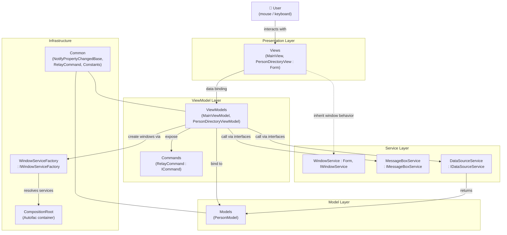
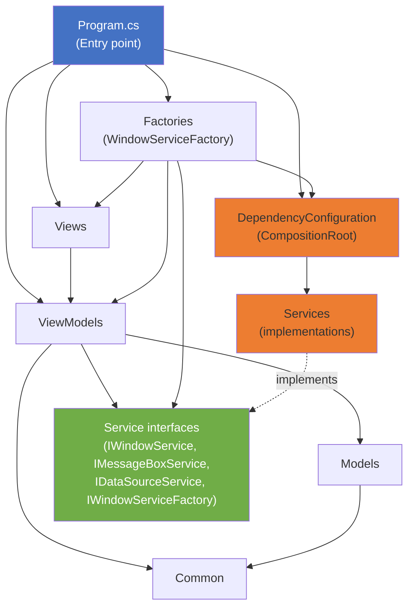
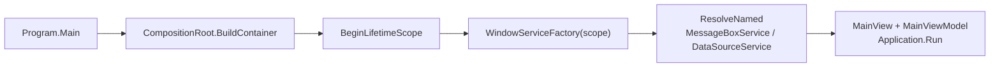

# MvvmWinFormsApp

Windows Forms application (**.NET Framework 4.7**, C# 8.0) built with the **MVVM** pattern and **Autofac** dependency injection, for browsing a **person directory** (Person).

---

## Table of Contents

1. [General Architecture](#general-architecture)
2. [Folders and Purpose](#folders-and-purpose)
3. [Project Dependency Diagram](#project-dependency-diagram)
4. [UML Class Diagram of the Person Domain](#uml-class-diagram-of-the-person-domain)
5. [Dependency Injection (Autofac)](#dependency-injection-autofac)
6. [Build and Run](#build-and-run)

---

## General Architecture

The project applies the **MVVM** (Model – View – ViewModel) pattern on top of WinForms. Views know only about their ViewModels; ViewModels know only about services and models through **abstractions** (interfaces). Concrete implementations are wired only at the composition point — `Program.Main` together with `CompositionRoot` (Composition Root).



**Key principles:**

| Principle | How it is implemented |
|---|---|
| Separation of concerns | `View` (UI only) / `ViewModel` (presentation logic) / `Model` (data) / `Service` (business data and UI wrappers) |
| Dependency Inversion | ViewModels depend on `IMessageBoxService`, `IDataSourceService`, `IWindowServiceFactory` — not on implementations |
| Composition Root | All «interface → implementation» bindings live in `DependencyConfiguration/CompositionRoot.cs` |
| Testability | ViewModels are UI-framework-agnostic (no direct `MessageBox`/`Form` calls), so they can be unit tested with mocks |
| Observable bindings | `NotifyPropertyChangedBase.SetProperty` raises `PropertyChanged` for data binding |

---

## Folders and Purpose

| Folder / File | Layer | Purpose |
|---|---|---|
| `Program.cs` | Entry point | Builds the Autofac container, creates the main window and starts the app |
| `Views/` | View | WinForms forms (`MainView`, `PersonDirectoryView`), data-bound to ViewModels |
| `ViewModels/` | ViewModel | Presentation logic (`MainViewModel`, `PersonDirectoryViewModel`), expose `RelayCommand`s |
| `Models/` | Model | Domain data (`PersonModel`: Id, Name, Age) |
| `Services/` | Service | `IWindowService` / `WindowService` (form behavior: Show, ShowDialog, SetMdiParent), `IMessageBoxService` / `MessageBoxService` (message boxes), `IDataSourceService` / `DataSourceService` (person data source) |
| `Factories/` | Infrastructure | `IWindowServiceFactory` / `WindowServiceFactory` — creates View + ViewModel pairs from the DI scope |
| `DependencyConfiguration/` | Infrastructure | `CompositionRoot` — builds the Autofac container and registers named singletons |
| `Common/` | Shared | `NotifyPropertyChangedBase` (INotifyPropertyChanged), `RelayCommand` (ICommand), `Constants` (service names) |
| `Enums/` | Shared | `WindowActionResult` (None / OK / Cancel / Yes / No) |

---

## Project Dependency Diagram

Arrow direction means «depends on». ViewModels and Models depend only on abstractions and `Common`; only the composition point touches concrete services and Autofac.



---

## UML Class Diagram of the Person Domain

End-to-end data path through the layers: `DataSourceService` → `PersonModel` → `PersonDirectoryViewModel` → data binding → `PersonDirectoryView`. The ViewModel never touches WinForms UI types directly.

```mermaid
classDiagram
    direction TB

    class IDataSourceService {
        <<interface>>
        +GetPersons() IList~PersonModel~
    }
    class DataSourceService {
        +GetPersons() IList~PersonModel~
    }

    class IMessageBoxService {
        <<interface>>
        +ShowMessage(message, title)
        +ShowConfirmation(message, title) bool
    }
    class MessageBoxService {
        +ShowMessage(message, title)
        +ShowConfirmation(message, title) bool
    }

    class PersonModel {
        +int Id
        +string Name
        +int Age
    }

    class PersonDirectoryViewModel {
        -messageBoxService : IMessageBoxService
        -dataSourceService : IDataSourceService
        +Persons : IList~PersonModel~
        +Person : PersonModel
        +ShowPersonCommand : RelayCommand
        -ExecuteShowPersonCommand(parameter)
        -CanExecuteShowPersonCommand(parameter) bool
    }

    class MainViewModel {
        -windowFactory : IWindowServiceFactory
        +ShowPersonDirectoryCommand : RelayCommand
        -ExecuteShowPersonDirectoryCommand(parameter)
    }

    class RelayCommand {
        +CanExecuteChanged : event
        +Execute(parameter)
        +CanExecute(parameter) bool
        +RaiseCanExecuteChanged()
    }

    class NotifyPropertyChangedBase {
        <<abstract>>
        +PropertyChanged : event
        #OnPropertyChanged(propertyName)
        #SetProperty(field, value, propertyName) bool
    }

    class IWindowServiceFactory {
        <<interface>>
        +CreatePersonDirectoryWindow() IWindowService
    }
    class WindowServiceFactory {
        -scope : ILifetimeScope
        +CreatePersonDirectoryWindow() IWindowService
    }

    class IWindowService {
        <<interface>>
        +Show()
        +Show(owner)
        +ShowDialog() WindowActionResult
        +ShowDialog(owner) WindowActionResult
        +SetMdiParent(parent)
    }
    class WindowService {
        <<Form>>
        +SetMdiParent(parent)
        +Show()
        +Show(owner)
        +ShowDialog() WindowActionResult
    }

    class PersonDirectoryView {
        <<Form>>
        -viewModel : PersonDirectoryViewModel
    }
    class MainView {
        <<Form>>
        -viewModel : MainViewModel
    }

    NotifyPropertyChangedBase <|-- PersonModel
    NotifyPropertyChangedBase <|-- PersonDirectoryViewModel
    NotifyPropertyChangedBase <|-- MainViewModel

    IDataSourceService <|.. DataSourceService
    IMessageBoxService <|.. MessageBoxService
    IWindowService <|.. WindowService
    IWindowServiceFactory <|.. WindowServiceFactory

    DataSourceService --> PersonModel : returns
    PersonDirectoryViewModel --> IDataSourceService : depends on
    PersonDirectoryViewModel --> IMessageBoxService : depends on
    PersonDirectoryViewModel --> PersonModel : binds
    PersonDirectoryViewModel --> RelayCommand : exposes
    MainViewModel --> IWindowServiceFactory : depends on
    MainViewModel --> RelayCommand : exposes
    WindowServiceFactory --> PersonDirectoryViewModel : creates
    WindowServiceFactory --> PersonDirectoryView : creates
    PersonDirectoryView --> PersonDirectoryViewModel : data binding
    MainView --> MainViewModel : data binding
    PersonDirectoryView --|> WindowService : inherits

    style IDataSourceService fill:#70ad47,color:#fff
    style IMessageBoxService fill:#70ad47,color:#fff
    style IWindowService fill:#70ad47,color:#fff
    style IWindowServiceFactory fill:#70ad47,color:#fff
    style PersonModel fill:#ed7d31
    style PersonDirectoryViewModel fill:#ed7d31
```



---

## Dependency Injection (Autofac)

The container is built once at application startup in `CompositionRoot.BuildContainer()`. Services are registered as **named singletons** and resolved through a lifetime scope that lives for the whole application run.



Registrations (`CompositionRoot.cs`):

| Service | Registration | Lifetime |
|---|---|---|
| `MessageBoxService` | named `Constants.MessageBoxServiceName` → `IMessageBoxService` | Singleton |
| `DataSourceService` | named `Constants.DataSourceServiceName` → `IDataSourceService` | Singleton |

`WindowServiceFactory` is the only place (besides `Program`) that knows about Autofac: it resolves services from the scope and composes View + ViewModel pairs, so Views and ViewModels stay container-agnostic.

---

## Build and Run

```bash
# Build (requires .NET Framework 4.7 targeting pack / Visual Studio)
dotnet build MvvmWinFormsApp.sln

# Run
dotnet run --project MvvmWinFormsApp
```

The application opens the MDI main window (`MainView`). The button bound to `ShowPersonDirectoryCommand` opens the person directory window (`PersonDirectoryView`) as an MDI child; selecting a person and pressing «Show» displays the person's details via `IMessageBoxService`.

### NuGet Packages

| Package | Purpose |
|---|---|
| `Autofac` 8.2.0 | Dependency injection container |
| `Autofac.Extras.CommonServiceLocator` 6.1.0 | CommonServiceLocator adapter for Autofac |
| `Microsoft.Bcl.AsyncInterfaces`, `System.Memory`, `System.Threading.Tasks.Extensions`, `System.Diagnostics.DiagnosticSource` | Backported async/disposable support for .NET Framework 4.7 |

> Note: the project also references legacy **Infragistics v9.1** assemblies (Shared / Win / Win.Misc) — they must be available in the GAC or next to the project to compile.

