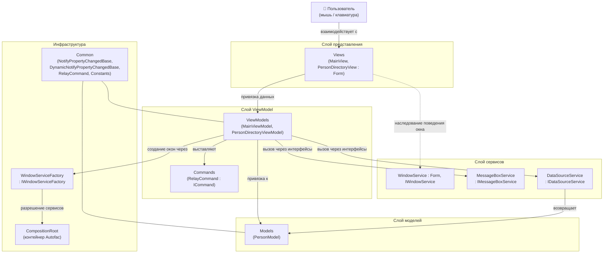
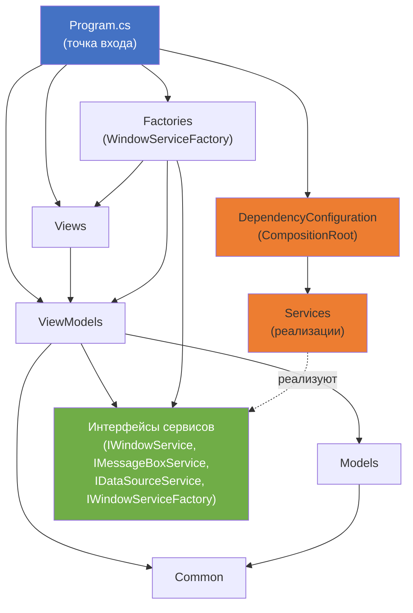
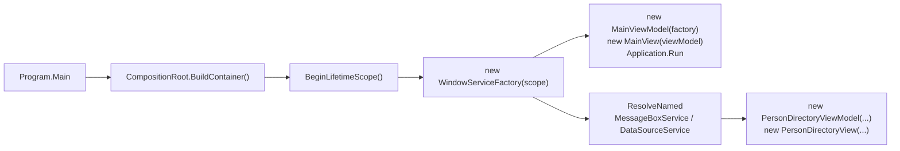

# MvvmWinFormsApp

Windows Forms-приложение (**.NET Framework 4.8**, C# 8.0), построенное по паттерну **MVVM** с внедрением зависимостей через **Autofac**, для просмотра **справочника персон** (Person).

---

## Содержание

1. [Общая архитектура](#общая-архитектура)
2. [Структура проекта](#структура-проекта)
3. [Диаграмма зависимостей](#диаграмма-зависимостей)
4. [Диаграмма классов домена «Персона»](#диаграмма-классов-домена-персона)
5. [Внедрение зависимостей (Autofac)](#внедрение-зависимостей-autofac)
6. [Сборка и запуск](#сборка-и-запуск)

---

## Общая архитектура

Проект реализует паттерн **MVVM** (Model – View – ViewModel) поверх WinForms. Views знают только о своих ViewModels; ViewModels работают с сервисами и моделями исключительно через **абстракции** (интерфейсы). Конкретные реализации связываются только в точке композиции — `Program.Main` совместно с `CompositionRoot`.



**Ключевые принципы:**

| Принцип | Реализация |
|---|---|
| Разделение ответственности | `View` (только UI) / `ViewModel` (презентационная логика) / `Model` (данные) / `Service` (данные и UI-обёртки) |
| Инверсия зависимостей | ViewModels зависят от `IMessageBoxService`, `IDataSourceService`, `IWindowServiceFactory` — не от реализаций |
| Composition Root | Все привязки «интерфейс → реализация» в `DependencyConfiguration/CompositionRoot.cs` |
| Тестируемость | ViewModels не содержат прямых вызовов `MessageBox`/`Form`, что позволяет покрывать их юнит-тестами с моками |
| Наблюдаемые привязки | `NotifyPropertyChangedBase.SetValue` и `DynamicNotifyPropertyChangedBase.SetValue` генерируют `PropertyChanged` для data binding |

---

## Структура проекта

```
MvvmWinFormsApp/
├── MvvmWinFormsApp.sln              # Решение (1 проект)
├── README.md
└── MvvmWinFormsApp/
    ├── Program.cs                   # Точка входа
    ├── App.config                   # Конфигурация (binding redirects)
    ├── MvvmWinFormsApp.csproj       # Проект (net48, LangVersion 8.0)
    ├── Common/                      # Общие утилиты
    │   ├── Constants.cs             # Имена сервисов для named-регистраций
    │   ├── NotifyPropertyChangedBase.cs
    │   ├── DynamicNotifyPropertyChangedBase.cs
    │   └── RelayCommand.cs          # namespace MvvmWinFormsApp.Commands
    ├── DependencyConfiguration/
    │   └── CompositionRoot.cs       # Сборка контейнера Autofac
    ├── Enums/
    │   └── WindowActionResult.cs    # None / OK / Cancel / Yes / No
    ├── Factories/
    │   ├── IWindowServiceFactory.cs
    │   └── WindowServiceFactory.cs
    ├── Models/
    │   └── PersonModel.cs
    ├── Services/
    │   ├── IWindowService.cs
    │   ├── WindowService.cs
    │   ├── IMessageBoxService.cs
    │   ├── MessageBoxService.cs
    │   ├── IDataSourceService.cs
    │   └── DataSourceService.cs
    ├── ViewModels/
    │   ├── MainViewModel.cs
    │   └── PersonDirectoryViewModel.cs
    ├── Views/
    │   ├── MainView.cs / .Designer.cs / .resx
    │   └── PersonDirectoryView.cs / .Designer.cs / .resx
    └── Properties/                  # AssemblyInfo, Resources, Settings
```

| Папка / Файл | Слой | Назначение |
|---|---|---|
| `Program.cs` | Точка входа | Строит контейнер Autofac, создаёт главное окно и запускает приложение |
| `Views/` | View | Формы WinForms (`MainView` — MDI-родитель с MenuStrip/ToolStrip, `PersonDirectoryView` — MDI-потомок с DataGridView), привязаны к ViewModels |
| `ViewModels/` | ViewModel | Презентационная логика (`MainViewModel`, `PersonDirectoryViewModel`), выставляют `RelayCommand` |
| `Models/` | Model | Доменные данные (`PersonModel`: Id, Name, Age) |
| `Services/` | Service | `IWindowService` / `WindowService` (поведение окна: Show, ShowDialog, SetMdiParent), `IMessageBoxService` / `MessageBoxService` (сообщения), `IDataSourceService` / `DataSourceService` (источник данных) |
| `Factories/` | Инфраструктура | `IWindowServiceFactory` / `WindowServiceFactory` — создаёт пары View + ViewModel из DI-scope |
| `DependencyConfiguration/` | Инфраструктура | `CompositionRoot` — строит контейнер Autofac, регистрирует named singletons |
| `Common/` | Общий | `NotifyPropertyChangedBase`, `DynamicNotifyPropertyChangedBase`, `RelayCommand` (namespace `MvvmWinFormsApp.Commands`), `Constants` |
| `Enums/` | Общий | `WindowActionResult` (None / OK / Cancel / Yes / No) |

### Базовые классы Common

| Класс | Назначение |
|---|---|
| `NotifyPropertyChangedBase` | Абстрактный класс: реализует `INotifyPropertyChanged`, метод `SetValue<T>(ref T field, T value, string propertyName)` — сравнение и уведомление |
| `DynamicNotifyPropertyChangedBase` | Наследник `NotifyPropertyChangedBase`: хранит свойства в `Dictionary<string, object>`, методы `GetValue<T>(propertyName)` / `SetValue<T>(value, propertyName)` — свойства без backing-полей |
| `RelayCommand` | `ICommand` с делегатами `execute`/`canExecute`, метод `RaiseCanExecuteChanged()` (namespace `MvvmWinFormsApp.Commands`) |
| `Constants` | Константы имён для named-регистраций Autofac |

---

## Диаграмма зависимостей

Направление стрелки означает «зависит от». ViewModels и Models зависят только от абстракций и `Common`; конкретные сервисы и Autofac известны только точке композиции.



---

## Диаграмма классов домена «Персона»

Сквозной путь данных: `DataSourceService` → `PersonModel` → `PersonDirectoryViewModel` → привязка данных → `PersonDirectoryView`. ViewModel не обращается к UI-типам WinForms напрямую.

```mermaid
classDiagram
    direction TB

    class IDataSourceService {
        <<interface>>
        +GetPersons() IList~PersonModel~
    }
    class DataSourceService {
        +GetPersons() IList~PersonModel~
    }

    class IMessageBoxService {
        <<interface>>
        +ShowMessage(message, title)
        +ShowConfirmation(message, title) bool
    }
    class MessageBoxService {
        +ShowMessage(message, title)
        +ShowConfirmation(message, title) bool
    }

    class NotifyPropertyChangedBase {
        <<abstract>>
        +PropertyChanged : event
        #OnPropertyChanged(propertyName)
        #SetValue~T~(ref field, value, propertyName) bool
    }
    class DynamicNotifyPropertyChangedBase {
        <<abstract>>
        -_properties : Dictionary~string, object~
        #GetValue~T~(propertyName) T
        #SetValue~T~(value, propertyName) bool
    }

    class PersonModel {
        +Id : int
        +Name : string
        +Age : int
        +ToString() string
    }

    class PersonDirectoryViewModel {
        -_messageBoxService : IMessageBoxService
        -_dataSourceService : IDataSourceService
        +Persons : IList~PersonModel~
        +Person : PersonModel
        +ShowPersonCommand : RelayCommand
        -ExecuteShowPersonCommand(parameter)
        -CanExecuteShowPersonCommand(parameter) bool
    }

    class MainViewModel {
        -_windowFactory : IWindowServiceFactory
        +ShowPersonDirectoryCommand : RelayCommand
        -ExecuteShowPersonDirectoryCommand(parameter)
    }

    class RelayCommand {
        +CanExecuteChanged : event
        +Execute(parameter)
        +CanExecute(parameter) bool
        +RaiseCanExecuteChanged()
    }

    class IWindowServiceFactory {
        <<interface>>
        +CreatePersonDirectoryWindow() IWindowService
    }
    class WindowServiceFactory {
        -_scope : ILifetimeScope
        +CreatePersonDirectoryWindow() IWindowService
    }

    class IWindowService {
        <<interface>>
        +Show()
        +Show(owner)
        +ShowDialog() WindowActionResult
        +ShowDialog(owner) WindowActionResult
        +SetMdiParent(parent)
    }
    class WindowService {
        <<Form>>
        +SetMdiParent(parent)
        +Show()
        +Show(owner)
        +ShowDialog() WindowActionResult
        +ShowDialog(owner) WindowActionResult
    }

    class PersonDirectoryView {
        <<Form>>
        -_personDirectoryViewModel : PersonDirectoryViewModel
    }
    class MainView {
        <<Form>>
        -_viewModel : MainViewModel
    }

    NotifyPropertyChangedBase <|-- DynamicNotifyPropertyChangedBase
    DynamicNotifyPropertyChangedBase <|-- PersonModel
    DynamicNotifyPropertyChangedBase <|-- PersonDirectoryViewModel
    NotifyPropertyChangedBase <|-- MainViewModel

    IDataSourceService <|.. DataSourceService
    IMessageBoxService <|.. MessageBoxService
    IWindowService <|.. WindowService
    IWindowServiceFactory <|.. WindowServiceFactory

    DataSourceService --> PersonModel : возвращает
    PersonDirectoryViewModel --> IDataSourceService : зависит от
    PersonDirectoryViewModel --> IMessageBoxService : зависит от
    PersonDirectoryViewModel --> PersonModel : привязка
    PersonDirectoryViewModel --> RelayCommand : выставляет
    MainViewModel --> IWindowServiceFactory : зависит от
    MainViewModel --> RelayCommand : выставляет
    WindowServiceFactory --> PersonDirectoryViewModel : создаёт
    WindowServiceFactory --> PersonDirectoryView : создаёт
    PersonDirectoryView --> PersonDirectoryViewModel : привязка данных
    MainView --> MainViewModel : привязка данных
    PersonDirectoryView --|> WindowService : наследует
    MainView --|> WindowService : наследует

    style IDataSourceService fill:#70ad47,color:#fff
    style IMessageBoxService fill:#70ad47,color:#fff
    style IWindowService fill:#70ad47,color:#fff
    style IWindowServiceFactory fill:#70ad47,color:#fff
    style PersonModel fill:#ed7d31
    style PersonDirectoryViewModel fill:#ed7d31
```



---

## Внедрение зависимостей (Autofac)

Контейнер строится один раз при запуске приложения в `CompositionRoot.BuildContainer()`. Сервисы регистрируются как **named singletons** и разрешаются через lifetime scope, живущий всё время работы приложения.



### Регистрации (`CompositionRoot.cs`)

| Сервис | Регистрация | Lifetime |
|---|---|---|
| `MessageBoxService` | named `Constants.MessageBoxServiceName` → `IMessageBoxService` | Singleton |
| `DataSourceService` | named `Constants.DataSourceServiceName` → `IDataSourceService` | Singleton |

### Поток создания окна

`WindowServiceFactory.CreatePersonDirectoryWindow()`:
1. `ResolveNamed<IMessageBoxService>(Constants.MessageBoxServiceName)` из scope
2. `ResolveNamed<IDataSourceService>(Constants.DataSourceServiceName)` из scope
3. `new PersonDirectoryViewModel(messageBoxService, dataSourceService)`
4. `new PersonDirectoryView(viewModel)` — возвращает как `IWindowService`

`WindowServiceFactory` — единственное место (кроме `Program`), знающее про Autofac: View и ViewModel остаются независимыми от контейнера.

### Соглашение по добавлению нового окна

1. Создать View (наследник `WindowService`) и ViewModel.
2. Добавить метод в `IWindowServiceFactory` / `WindowServiceFactory`.
3. При необходимости зарегистрировать новые сервисы в `CompositionRoot`.

---

## Сборка и запуск

```bash
# Сборка (требуется .NET Framework 4.8 targeting pack / Visual Studio)
dotnet build MvvmWinFormsApp.sln

# Запуск
dotnet run --project MvvmWinFormsApp
```

Приложение открывает MDI-главное окно (`MainView`). Пункт меню **«Модули → Справочник персон»** или кнопка на панели инструментов открывает окно справочника (`PersonDirectoryView`) как MDI-потомок. Выбор строки в таблице и нажатие кнопки **«Просмотр»** на панели навигации отображает данные персоны (`Id`, `Name`, `Age`) через `IMessageBoxService`.

### NuGet-пакеты

| Пакет | Версия | Назначение |
|---|---|---|
| `Autofac` | 8.2.0 | Контейнер внедрения зависимостей |
| `Autofac.Extras.CommonServiceLocator` | 6.1.0 | Адаптер CommonServiceLocator для Autofac |
| `Microsoft.Bcl.AsyncInterfaces` | 9.0.3 | Бэкпорт async-интерфейсов для net48 |
| `System.Diagnostics.DiagnosticSource` | 9.0.3 | Диагностика |
| `System.Memory` | 4.6.2 | Бэкпорт Span/Memory для net48 |
| `System.Threading.Tasks.Extensions` | 4.6.2 | Бэкпорт ValueTask для net48 |

---

## Известные особенности

- `DataSourceService.GetPersons()` возвращает захардкоженный список из трёх персон — при переходе к реальным данным достаточно заменить реализацию `IDataSourceService`.
- `Constants.PersonDirectoryViewName` объявлен, но пока нигде не используется.
- `Autofac.Extras.CommonServiceLocator` подключён как пакет, но в коде не задействован.
- Файл `Common/RelayCommand.cs` лежит в папке `Common`, но имеет namespace `MvvmWinFormsApp.Commands`.
- Тестовый проект отсутствует.

